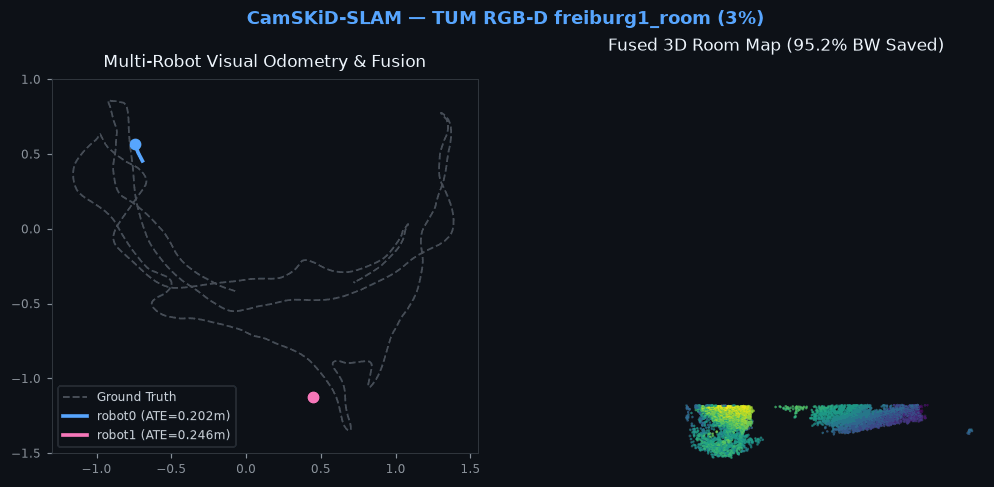
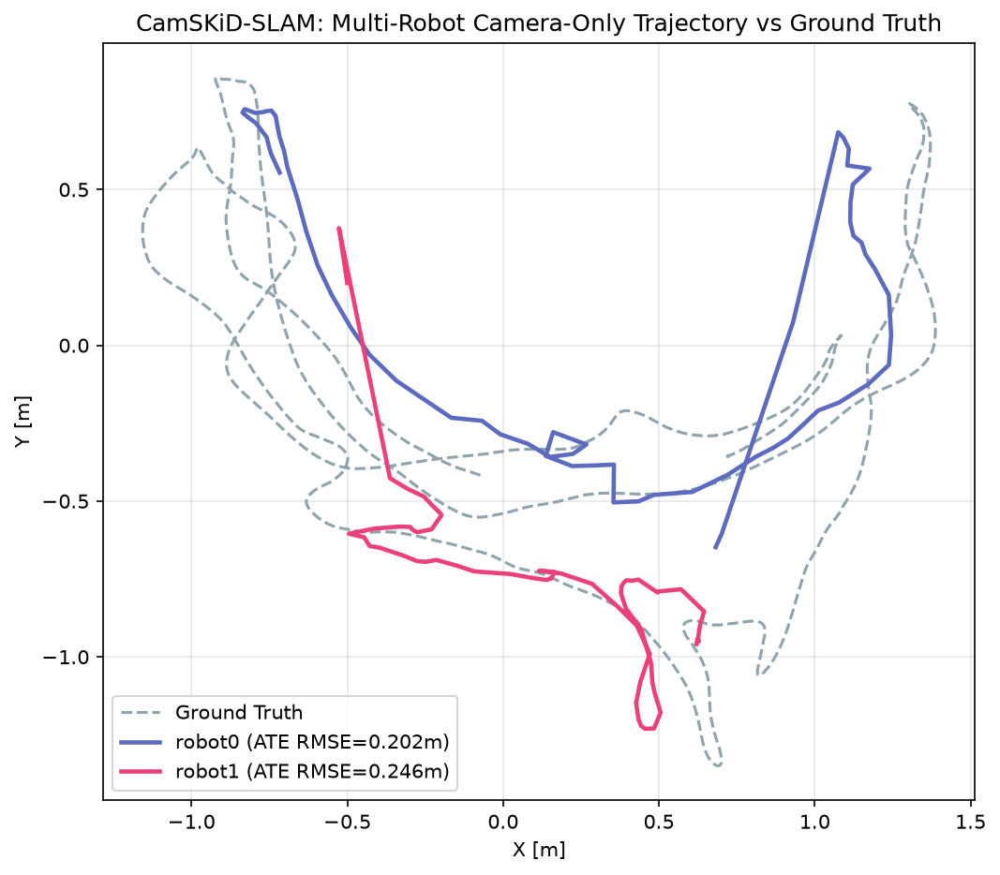
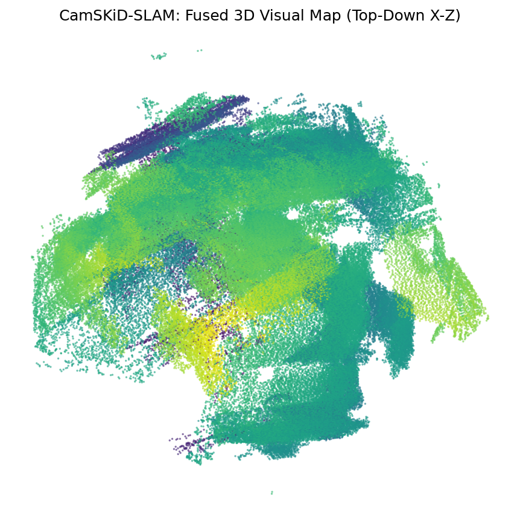

<div dir="rtl" align="center">

# CamSKiD-SLAM

**سیستم SLAM چندرباته توزیع‌شده و آگاه از منابع — فقط با دوربین**

[](https://isocpp.org/)
[](https://docs.ros.org/en/jazzy/)
[](https://gtsam.org/)
[](LICENSE)

**🌐 زبان / Language:** [English](README.md) | **فارسی**



</div>

---

<div dir="rtl">

## معرفی پروژه

**CamSKiD-SLAM** معماری توزیع‌شده و کم‌مصرف پروژه [SKiD-SLAM](https://github.com/sparolab/SKiD-SLAM) را از **LiDAR سه‌بعدی + IMU** به **فقط دوربین (Camera-Only)** بازطراحی می‌کند؛ به این ترتیب نیاز به حسگرهای گران‌قیمت LiDAR حذف می‌شود در حالی که تبادل توصیف‌گرهای کم‌حجم، حذف حلقه‌های اشتباه و ادغام سراسری نقشه حفظ می‌گردد.

هر ربات ادومتری بصری خود را به‌طور مستقل اجرا می‌کند و به‌جای ارسال تصاویر خام یا ابرنقاط حجیم، فقط **توصیف‌گرهای فشرده کی‌فریم** را با سایر ربات‌ها به اشتراک می‌گذارد:

1. **ادومتری بصری فقط-دوربین (`cam_skid_vo`):**
   - استخراج ویژگی‌های ORB، تطبیق Lowe's ratio، رفع دیستورشن لنز (`cv::undistortPoints`) و تخمین حرکت دو مرحله‌ای (`EPnP` RANSAC ← `SOLVEPNP_ITERATIVE`).
   - ردیابی مستقیم **Frame-to-Keyframe** برای جلوگیری از انباشت دریفت.
   - فیلتر لبه‌های عمق (حذف نقاط پرنده) + وکسل‌سازی دقیق (`2.5 cm`).
   - ارسال تنها ۲۶۰ ویژگی برتر هر کی‌فریم به همراه یک **توصیف‌گر سراسری ۶۴بعدی (۲۵۶ بایت)**.
2. **تشخیص حلقه چندرباته و ادغام نقشه (`cam_skid_fusion`):**
   - **مرحله ۱ (بازیابی مکان):** شباهت کسینوسی روی توصیف‌گرهای ۲۵۶ بایتی بین ربات‌ها (و حلقه‌های درون‌رباتی).
   - **مرحله ۲ (تایید هندسی سه‌بعدی):** تطبیق ORB + رجیستریشن `RANSAC SVD` سه‌بعدی.
   - **مرحله ۳ (هم‌ترازی دقیق):** پالایش با `ICP` و کنترل خطای برازش.
   - **مرحله ۴ (حذف داده‌های پرت):** الگوریتم **PCM (Pairwise Consistency Maximization)** برای نگه داشتن حلقه‌های سازگار.
   - **مرحله ۵ (بهینه‌سازی گراف ژست‌ها):** **GTSAM 4.2.0** (بهینه‌ساز `LevenbergMarquardt` با تابع خطای مقاوم **Huber**) تمام ربات‌ها را در فریم مشترک `world` ادغام کرده و نقشه را با `StatisticalOutlierRemoval` پاک‌سازی می‌کند.

---

## نتایج بنچمارک (دیتاست واقعی TUM RGB-D `freiburg1_room`)

ارزیابی در برابر `groundtruth.txt` با هم‌ترازی Umeyama SE(3) (با ۲۰٪ هم‌پوشانی مسیر بین `robot0` و `robot1`):

| معیار | مقدار |
| --- | --- |
| خطای `robot0` (ATE RMSE / Mean / Max) | **0.2018 m** / 0.1880 m / 0.3535 m |
| خطای `robot1` (ATE RMSE / Mean / Max) | **0.2463 m** / 0.2326 m / 0.4011 m |
| کاهش پهنای باند توصیف‌گرها | **۹۵.۱۹٪** (1.52 MB در برابر 31.68 MB ابرنقاط) |
| تست واحد C++ (`test_pcm`) | **PASS** (`RANSAC 3D trans_err = 9.69e-16`, `PCM 4/6`) |

<p align="center">
  
  
</p>

---

## نحوه بیلد و اجرا (ROS 2 Jazzy)

### ۱. بیلد پروژه

```bash
source /opt/ros/jazzy/setup.bash
cd <your_ros2_ws>
colcon build --base-paths <path_to>/CamSKiD-SLAM \
  --cmake-args -DCMAKE_BUILD_TYPE=Release \
  -DCMAKE_PREFIX_PATH=<path_to_gtsam_install>
```

### ۲. لانچ SLAM چندرباته + RViz2

```bash
source /opt/ros/jazzy/setup.bash
source <your_ros2_ws>/install/setup.bash
export LD_LIBRARY_PATH=<path_to_gtsam_install>/lib:$LD_LIBRARY_PATH

ros2 launch cam_skid_slam cam_skid.launch.py rviz:=true save_dir:=./cam_skid_results
```

### ۳. پخش دیتاست TUM RGB-D (تقسیم به ۲ ربات)

```bash
source /opt/ros/jazzy/setup.bash
python3 scripts/tum_multirobot_player.py \
  --dataset /path/to/rgbd_dataset_freiburg1_room \
  --fps 15 --stride 2
```

### ۴. ارزیابی خطا (ATE) و رسم نمودارها

```bash
python3 scripts/evaluate_and_plot.py \
  --results ./cam_skid_results \
  --gt /path/to/rgbd_dataset_freiburg1_room/groundtruth.txt
```

### ۵. اجرای تست واحد C++

```bash
g++ -std=c++17 -O2 -Iinclude -I/usr/include/eigen3 tests/test_pcm.cpp -o tests/test_pcm && ./tests/test_pcm
```

---

## قدردانی

الهام‌گرفته و بازطراحی‌شده بر پایه [sparolab/SKiD-SLAM](https://github.com/sparolab/SKiD-SLAM) و ساخته‌شده با ROS 2 Jazzy، GTSAM 4.2، OpenCV و PCL.

</div>
