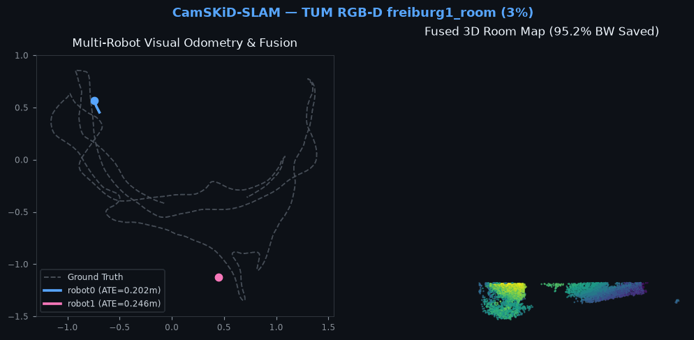
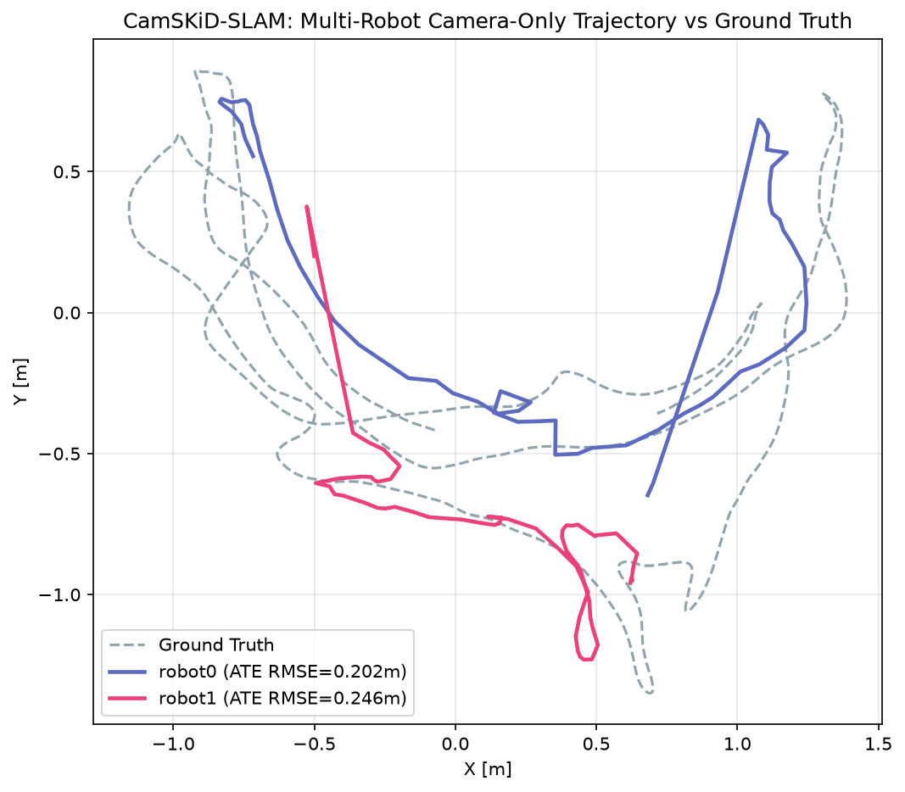
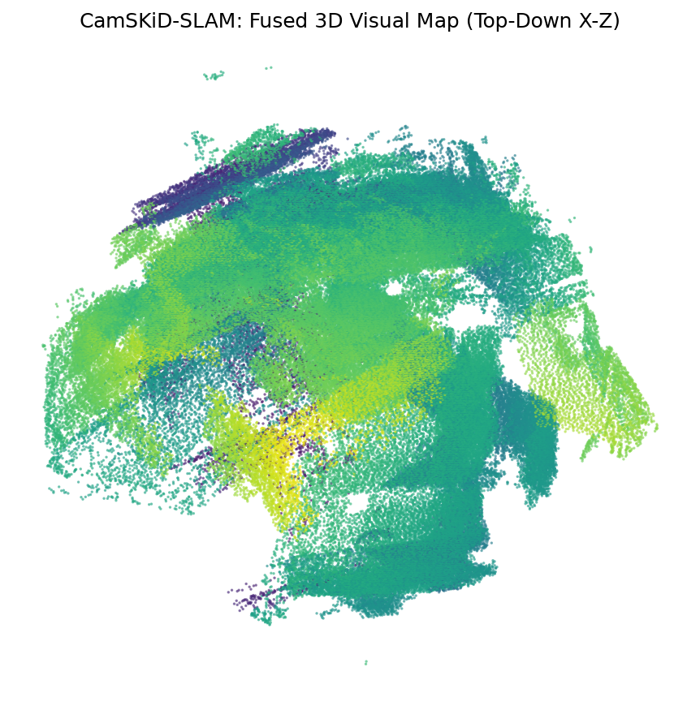

<div align="center">

# CamSKiD-SLAM

**Camera-Only Resource-Aware Distributed Multi-Robot SLAM**

[](https://isocpp.org/)
[](https://docs.ros.org/en/jazzy/)
[](https://gtsam.org/)
[](LICENSE)

**🌐 Language / زبان:** **English** | [فارسی](README.fa.md)



</div>

---

## Overview

**CamSKiD-SLAM** adapts the resource-aware distributed multi-robot SLAM paradigm of [SKiD-SLAM](https://github.com/sparolab/SKiD-SLAM) from 3D LiDAR + IMU to **pure camera-only** operation—eliminating expensive LiDAR sensors while preserving low-bandwidth descriptor exchange, geometric outlier rejection, and global pose-graph fusion.

Each robot runs an independent visual odometry front-end and shares **compact keyframe descriptors** instead of raw camera streams or dense point clouds:

1. **Camera-Only Visual Odometry (`cam_skid_vo`):**
   - ORB feature extraction, Lowe's ratio matching, lens distortion compensation (`cv::undistortPoints`), and two-stage PnP (`EPnP` RANSAC → `SOLVEPNP_ITERATIVE` refinement).
   - Direct **Frame-to-Keyframe** tracking to prevent frame-to-frame drift accumulation.
   - Depth-edge discontinuity filtering (rejecting flying pixels) + voxel downsampling (`2.5 cm`).
   - Ranks keypoints by response and transmits only the top 260 descriptors + a **64-dim (256-byte) global visual descriptor** per keyframe.
2. **Distributed Multi-Robot Loop Closure & Map Fusion (`cam_skid_fusion`):**
   - **Stage 1 (Place Recognition):** Cosine similarity retrieval on 256-byte global descriptors across robots (plus non-adjacent intra-robot loops).
   - **Stage 2 (3D Geometric Verification):** ORB matching + 3D-to-3D RANSAC SVD registration (`ransacRigidRegistration`).
   - **Stage 3 (Fine Alignment):** PCL `IterativeClosestPoint` (ICP) refinement with fitness gating.
   - **Stage 4 (Outlier Rejection):** **Pairwise Consistency Maximization (PCM)** (`filterLoopsWithPCM`) extracts the maximum mutually consistent clique of inter-robot loops.
   - **Stage 5 (Global Pose-Graph Optimization):** **GTSAM 4.2.0** (`LevenbergMarquardtOptimizer` with Huber robust loss) fuses all robots into a unified `world` TF frame (`world -> <robot>/odom -> <robot>/camera_link`), followed by `pcl::StatisticalOutlierRemoval`.

---

## Benchmark Results (TUM RGB-D `freiburg1_room`, 2-Robot Split)

Evaluated against `groundtruth.txt` with SE(3) Umeyama alignment (`20%` trajectory overlap between `robot0` and `robot1`):

| Metric | Value |
| --- | --- |
| `robot0` ATE RMSE / Mean / Max | **0.2018 m** / 0.1880 m / 0.3535 m |
| `robot1` ATE RMSE / Mean / Max | **0.2463 m** / 0.2326 m / 0.4011 m |
| Descriptor Bandwidth Reduction | **95.19%** (1.52 MB descriptors vs. 31.68 MB submap clouds) |
| C++ Unit Tests (`test_pcm`) | **PASS** (`RANSAC 3D trans_err = 9.69e-16`, `PCM 4/6`) |

<p align="center">
  
  
</p>

---

## Build & Run (ROS 2 Jazzy)

### 1. Build

```bash
source /opt/ros/jazzy/setup.bash
cd <your_ros2_ws>
colcon build --base-paths <path_to>/CamSKiD-SLAM \
  --cmake-args -DCMAKE_BUILD_TYPE=Release \
  -DCMAKE_PREFIX_PATH=<path_to_gtsam_install>
```

### 2. Launch Multi-Robot SLAM + RViz2

```bash
source /opt/ros/jazzy/setup.bash
source <your_ros2_ws>/install/setup.bash
export LD_LIBRARY_PATH=<path_to_gtsam_install>/lib:$LD_LIBRARY_PATH

ros2 launch cam_skid_slam cam_skid.launch.py rviz:=true save_dir:=./cam_skid_results
```

### 3. Stream TUM RGB-D Sequence (2-Robot Split)

```bash
source /opt/ros/jazzy/setup.bash
python3 scripts/tum_multirobot_player.py \
  --dataset /path/to/rgbd_dataset_freiburg1_room \
  --fps 15 --stride 2
```

### 4. Evaluate ATE & Generate Plots

```bash
python3 scripts/evaluate_and_plot.py \
  --results ./cam_skid_results \
  --gt /path/to/rgbd_dataset_freiburg1_room/groundtruth.txt
```

### 5. Run C++ Unit Tests

```bash
g++ -std=c++17 -O2 -Iinclude -I/usr/include/eigen3 tests/test_pcm.cpp -o tests/test_pcm && ./tests/test_pcm
```

---

## Acknowledgements

Inspired by and adapted from [sparolab/SKiD-SLAM](https://github.com/sparolab/SKiD-SLAM). Built with ROS 2 Jazzy, GTSAM 4.2, OpenCV, and PCL.
